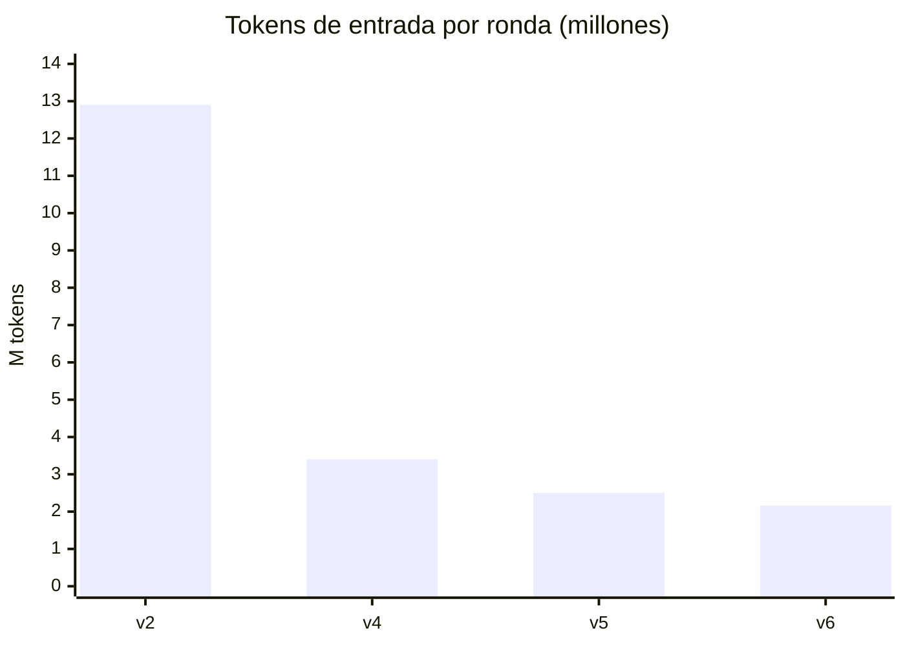
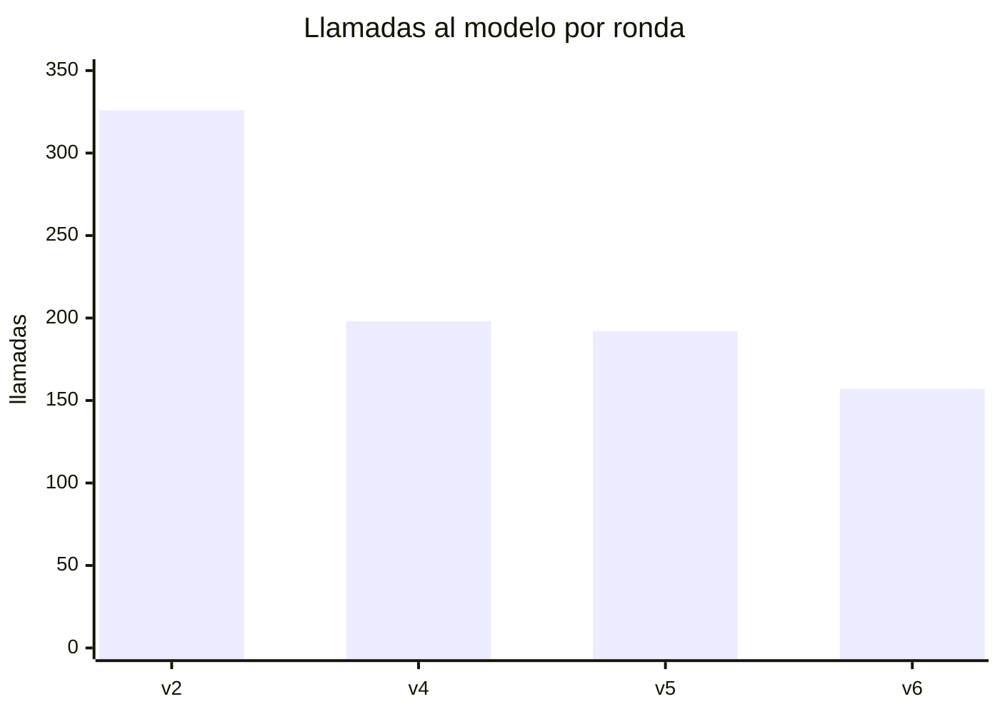
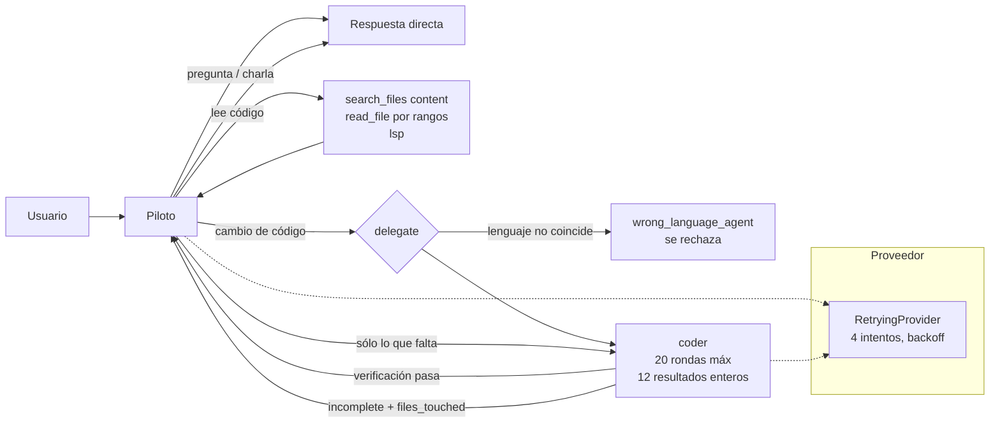

# Estado del flujo piloto — 2026-10-22

## Estado actual

**Fase 6b hecha: el flujo legacy está borrado.** Solo queda el piloto.

- Borrados: `DefaultOrchestrator`, planner, graph runner, los flujos por regex (chat,
  diagrama, escritorio, web, catálogo), modo plan antiguo, sus prompts y el spec
  `orchestrator`, y la opción `orchestration.mode` (más `refine_goal`/`direct_reply`).
- Nuevo: tool `describe_runtime` (el piloto responde «¿qué agentes/skills/modelo
  tienes?» desde los registros). `doctor` comprueba que el piloto esté cargado.
- Una config antigua con `"mode": "legacy"` sigue cargando, pero obtiene el piloto.
- Tests: **1869 passed, 5 skipped**; ruff, mypy y bandit limpios. Sin commit.
- Prueba real tras el cambio: saludo, pregunta-codigo y cambio, los tres 2/2.

## Evolución del benchmark

| Ronda | Llamadas | Tokens de entrada | Tiempo total | Comprobaciones |
|---|---|---|---|---|
| v2 — piloto con límite | 326 | 12,9 M | ~43 min | 9/10 |
| v4 — presupuesto delegados, continuación, pilot por defecto, reintentos | 198 | 3,4 M | ~21 min | 10/10 |
| v5 — `code_task` con `path`, búsqueda por contenido, chequeo de lenguaje | 192 | 2,5 M | ~13,5 min | 10/10 |
| v6 — 12 resultados enteros + contexto del piloto | 157 | 2,16 M | ~19 min* | 10/10 |

\* En v6 el proveedor tuvo caídas: «cambio» y «hazlo» se repitieron aparte cuando volvió
la conexión, y las llamadas tardaron más de lo normal. El tiempo no es comparable; las
llamadas y los tokens sí.

| «hazlo» | Llamadas | Entrada | Delegaciones |
|---|---|---|---|
| v5 | 93 | 1,35 M | coder → coder → auditor |
| v6 | 58 | 1,05 M | coder → coder (sin auditor) |

## Cómo fluye un turno

## Lo que queda pendiente

- El modal de alternativas (`plan_options`) de TUI, escritorio y CLI ya no se alcanza
  (el modo plan del piloto pregunta con `ask_user`): se puede borrar.
- MCP: `ask_user` llega como texto; falta traducirlo a elicitación.
- `ExecutionGraph` y los schemas del planner (`agents/schemas.py`) quedan sin uso.
- La app Electron en modo dev sigue con el backend anterior; hay que reiniciarla.
