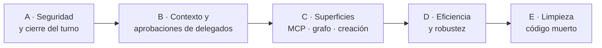

# Plan de correcciones — 2026-10-22

Errores encontrados en la auditoría del flujo piloto (benchmarks v2–v6, fase 6b y la
revisión posterior). Cada punto dice el síntoma, la causa con su sitio en el código, el
arreglo y cómo se comprueba. Todos los de las fases A–C están **verificados**: se
reprodujeron (script en el scratchpad de la sesión) o se confirmaron leyendo el código.

| Fase | Errores | Riesgo si no se hace |
|---|---|---|
| A | 1 permisos de tools, 7 tool desconocida, 8 memoria bloqueante | Escrituras no autorizadas; UI desincronizada; «pensando» tras responder |
| B | 2 canal de aprobación, 4 AGENTS.md en delegados, 6 presupuesto | Pregunta por consola en escritorio; delegados ignoran las reglas del proyecto |
| C | 5 cancelar por MCP, 9 grafo que ya no existe, 3 crear agentes | Funciones visibles que fallan o mienten |
| D | 10 reintentos cortos, 11 relecturas y rondas agotadas, 12 `run_command` en coders | Turnos caídos por cortes; coste |
| E | 13 modal de alternativas, 14 schemas y restos del planner, 15 rutas por regex en `chat.py` | Deuda; confusión |

---

## Fase A · Seguridad y cierre del turno

> **Hecha.** Tests en `tests/test_turn_safety.py` (8). 1: `LLMAgent._offered_tool_denial`
> (`agents/runtime.py`). 7: `ToolRegistry.execute` devuelve `unknown_tool`, y
> `PilotOrchestrator.execute` cierra con `TASK_FINISHED` ante cualquier excepción. 8:
> `ChatSession._summarize_later` + `flush_background()` (lo esperan el turno siguiente,
> la salida de la TUI, la CLI y el script de evaluación).

### 1. El modo plan (y cualquier agente) puede usar tools que no tiene
- **Síntoma.** En modo plan, un `write_file` simulado creó el archivo aunque al piloto no
  se le ofreció. Igual con delegados: un auditor podría escribir.
- **Causa.** `LLMAgent._run_tool` ejecuta contra el registro global
  (`satellite/agents/runtime.py:856`) y la política es la de la sesión
  (`DefaultSecurityPolicy.allowed_tools`), que permite `write_file`. La lista de tools del
  agente sólo decide qué se **ofrece** al modelo, no qué se **ejecuta**.
- **Arreglo.** En `_run_tool`, antes de ejecutar: si `call.name` no está en
  `{t.id for t in self.tools}` (más `request_context`, que siempre vale), devolver
  `ToolResult(success=False, error_code="tool_not_offered")` sin ejecutar y emitir
  `TOOL_CALLED` con el fallo. Pasar también `allowed_tools` a `policy.check_tool`
  en `ToolRegistry.execute` como segunda red.
- **Test.** Modo plan + `write_file` → no se crea el archivo y el modelo recibe el error.
  Auditor con `write_file` fuera de su spec → denegado. Coder con `write_file` → permitido.

### 7. Una tool desconocida tumba el turno sin `TASK_FINISHED`
- **Síntoma.** El chat dice «Tool no registrada: 'no_existe'», el turno muere y el bus
  nunca recibe `TASK_FINISHED`: TUI/escritorio pueden quedarse «en curso».
- **Causa.** `ToolRegistry.get` lanza `ToolError` **fuera** del `try` de
  `ToolRegistry.execute` (`satellite/tools/registry.py:76`); la excepción sale de
  `PilotOrchestrator.execute` sin pasar por `_finish`.
- **Arreglo.** (a) Mover el `get` dentro del `try` → el modelo recibe
  `error_code="unknown_tool"` y puede corregir. (b) En `PilotOrchestrator.execute`,
  envolver el turno en `try/except Exception` que siempre termina en `_finish` con un
  resultado fallido (cualquier excepción futura cierra el turno igual).
- **Test.** Tool desconocida → turno `ok` tras corregir, con `TASK_FINISHED`. Excepción
  arbitraria del agente → turno `failed` con `TASK_FINISHED`.

### 8. El resumen de memoria bloquea la entrega
- **Síntoma.** `TASK_FINISHED` a los 0,01 s, pero `ChatSession.send()` devuelve a los
  2,02 s con un resumidor de 2 s: el usuario ve el texto y la UI sigue «pensando».
- **Causa.** `send` hace `await self._record_turn_summary(...)` (una llamada LLM del rol
  `context`) antes de devolver la respuesta (`satellite/orchestration/chat.py:720` y `:684`).
- **Arreglo.** Lanzar el resumen como tarea en segundo plano (`asyncio.create_task`)
  guardada en la sesión; el turno siguiente la espera (con timeout) antes de leer la
  memoria, y `close()`/salida de la TUI la drena. Si falla, se guarda el resumen
  determinista de respaldo que ya existe.
- **Test.** Con resumidor lento, `send` devuelve en < 0,2 s; el resumen aparece en el
  turno siguiente; dos turnos seguidos no pierden resúmenes.

---

## Fase B · Contexto y aprobaciones de los delegados

> **Hecha.** Tests en `tests/test_delegation_channels.py` (8). 2: `DelegationManager`
> pide las aprobaciones por el puerto del turno (`_approve(ctx, port, …)`). 2b (nuevo,
> encontrado al revisar 2): MCP construía el runtime sin su `McpApproval`, así que en
> modo `ask` una aprobación caía en `CliApproval`, que lee de stdin, el canal del
> protocolo; ahora se pasa al runtime. 4: el delegado recibe `AGENTS.md`
> (`_project_rules`). 6: `TokenLedger` compartido por la cadena del turno y
> `llm.delegation.token_budget` en la config (sin tope si no se pone).

### 2. La delegación pide aprobación por el canal global
- **Síntoma.** En escritorio/TUI, una aprobación de delegación puede salir por consola.
- **Causa.** `DelegationManager._approve` usa `self.approval` (el puerto global) en vez
  del puerto del turno que ya recibe `delegate()` (`satellite/orchestration/delegation.py:270`).
  TUI y escritorio construyen el runtime sin puerto → en modo `ask` es `CliApproval`.
  Alcance: escalado de permisos y `can_call` (agentes creados por el usuario o un
  delegado que delega).
- **Arreglo.** `_approve(..., approval=...)` con el puerto del turno y caída al global sólo
  si no hay. Además, `Session.runtime()` de la TUI no debería quedar con `CliApproval`
  como global en una superficie gráfica: usar un puerto que deniegue y avise.
- **Test.** Delegar en un agente de usuario con puerto de turno → pregunta ese puerto, no
  el global.

### 4. Los delegados no reciben AGENTS.md
- **Síntoma.** Las reglas del proyecto llegan al piloto pero no al coder.
- **Causa.** `DelegationManager.delegate` crea el contexto como `ContextBundle()` vacío
  (`delegation.py:212`).
- **Arreglo.** Resolver `instructions_ref` del proyecto con el motor de contexto y
  pasarlo como sección del bundle del delegado (va en la parte dinámica, no rompe la caché
  del prefijo).
- **Test.** Con `AGENTS.md` en el proyecto, la primera petición del coder contiene sus
  reglas.

### 6. El presupuesto de tokens de delegación no descuenta
- **Síntoma.** Con presupuesto 50 y dos delegaciones de 100, siguen quedando 50.
- **Causa.** `parent_ctx.child(agent_id)` crea el hijo con `tokens_used=0` y el padre no
  acumula lo que gastan sus hijos. Hoy `build_runtime` no configura `token_budget`, así
  que no tiene efecto en producción.
- **Arreglo.** Decidir: (a) acumular el consumo en un contador compartido por la raíz del
  turno y exponer `llm.delegation_token_budget`; o (b) quitar el presupuesto si no se va a
  usar. Recomendación: (a), porque es la red contra un «hazlo» que se dispara.
- **Test.** Presupuesto 150, dos delegaciones de 100 → la segunda se rechaza.

---

## Fase C · Superficies que fallan o mienten

> **Hecha.** 5 (`tests/test_mcp_cancel.py`, 5 tests): `satellite_run` registra la
> ejecución antes de empezar, con la ruta y un `task_id` opcional elegido por el
> cliente; `satellite_cancel` sin id cancela todo lo que esté en curso; `serve()` atiende
> peticiones a la vez (bucle de eventos persistente). Encontrado de paso: cada
> elicitación abría un lector de stdin que nunca terminaba y competía con el bucle
> principal; ahora hay un solo lector que entrega las respuestas. 9
> (`tests/test_turn_trace.py`, 5 tests): el piloto guarda la traza del turno en el estado y
> CLI `inspect`, TUI `/inspect`, el detalle de tarea del escritorio y `satellite_trace`
> (antes `satellite_graph`) la muestran. 3 (`tests/test_create_agent_tool.py`, 4 tests):
> tool `create_agent` que llama al expander con el puerto del turno; `agent_creator` ya
> no es destino de delegación del piloto.

### 5. Cancelar por MCP no funciona
- **Síntoma.** Durante la ejecución: «no hay ejecución que cancelar». Después:
  `TypeError: ... not 'dict'`.
- **Causa.** `satellite_run` registra la tarea en `bundle._active` **después** de
  `execute` y guarda el dict del runtime en vez de la ruta (`satellite/mcp/handlers.py:56-57`);
  `satellite_cancel` luego hace `bundle.get(dict)`. Además el servidor atiende cada
  petición con `asyncio.run` de una en una (`satellite/mcp/server.py:112`), así que una
  cancelación no puede llegar mientras corre otra.
- **Arreglo.** Registrar `task_id → root` antes de ejecutar y quitarlo en `finally`;
  servidor con un bucle de eventos persistente que atienda peticiones concurrentes (la
  ejecución como tarea, `satellite_cancel` respondiendo mientras tanto).
- **Test.** Cancelar a mitad de un turno con un agente lento → el turno acaba `cancelled`.
  Cancelar un id terminado → «no hay ejecución», sin excepción.

### 9. Ver el grafo de una tarea ya no tiene datos *(introducido en la fase 6b)*
- **Síntoma.** `/graph` (TUI), el detalle de tarea del escritorio, `satellite_graph` (MCP)
  y `satellite graph` (CLI) leen `store.load_graph`, pero sin planner nadie lo guarda.
- **Sitios.** `satellite/tui/app.py:786`, `satellite/desktop/backend.py:957`,
  `satellite/mcp/handlers.py:78`, `satellite/cli/app.py:273`.
- **Arreglo.** Sustituir el grafo por la **traza del turno** que sí existe: delegaciones
  (agente, estado, tokens, `files_touched`) y tools usadas. Guardarla en `_finish` del
  piloto (`store.save_state` ya existe) y que las cuatro superficies la muestren.
- **Test.** Tras un turno con una delegación, cada superficie devuelve la traza.

### 3. Crear un agente desde el chat no lo registra
- **Síntoma.** El piloto delega en `agent_creator`, recibe una propuesta y lo da por hecho;
  el agente no existe.
- **Causa.** `agent_creator` sólo produce el JSON `ProposedAgent`; la validación, la
  aprobación y el registro viven en `AgentExpander`, que la delegación no llama.
- **Arreglo.** Tool `create_agent(need)` para el piloto que llama a
  `expander.expand(need, approval_port=<puerto del turno>)` y devuelve el resultado real
  (`created` / `reuse` / `rejected` / `needs_clarification`). Quitar `agent_creator` de los
  destinos de delegación del piloto y del prompt.
- **Test.** «crea un agente que resuma PDFs» → el agente queda en el catálogo tras
  aprobar; rechazado → el piloto lo dice.

---

## Fase D · Eficiencia y robustez (de los benchmarks)

> **Hecha.** 10 (`tests/test_provider_retry.py`, +3): 6 intentos con base de 2 s y tope
> de 30 s (≈1 min de margen) y `Retry-After` respetado hasta 60 s. 11
> (`tests/test_repeated_reads.py`, 4): el runtime no relee un rango que sigue entero en la
> conversación (se invalida al escribir el archivo); una delegación incompleta devuelve
> `files_read`; `scripts/eval_flow.py --repeat N`. 12 (`tests/test_command_hints.py`, 16):
> un `run_command` fallido dice qué tool usar (`code_task` para tests; `read_file`,
> `list_dir` o `search_files` para mirar archivos).

### 10. Los reintentos no aguantan un corte de minutos
- **Visto en v6.** «cambio» y «hazlo» fallaron con `Connection error` tras ~17 s.
- **Arreglo.** Por defecto 6 intentos con tope de 30 s (≈1–2 min de margen) y respetar
  `Retry-After`. Mantener `llm.retry` configurable.
- **Test.** Unidad con reloj falso: 5 fallos y éxito → turno ok; aviso «reconectando» en
  cada intento.

### 11. Los coders releen y agotan las rondas en tareas grandes
- **Visto.** «hazlo»: v5 coder → coder → auditor (93 llamadas); v6 coder → coder
  (58 llamadas), ambos agotando 20 rondas; `read_file` es la tool más usada.
- **Arreglo.** (a) Dedupe de lecturas: si el delegado pide un rango ya leído y sigue en
  contexto, responder «ya lo tienes arriba» en vez de releer. (b) El resultado de una
  delegación incompleta incluye un resumen de lo leído para que la continuación no
  empiece de cero. (c) Medir con **3 corridas** por caso (una sola corrida varía mucho).
- **Criterio.** «hazlo» en una sola delegación en 2 de 3 corridas.

### 12. Los coders siguen intentando `run_command`
- **Visto en v6.** `run_command×4` en «hazlo» (en la evaluación siempre se deniega).
- **Arreglo.** Revisar qué piden con él; si es buscar o ejecutar tests, el prompt ya
  apunta a `search_files`/`code_task` → convertir el error de denegación en una pista
  concreta («usa code_task para tests»).

---

### Revisión posterior (2026-10-22)

- **Sesión en los delegados.** `DelegationContext` no tenía `session_id` y el hijo recibía
  una sesión vacía: un permiso «para esta sesión» (control del escritorio) se comportaba
  como uno de una sola tarea al usarlo un delegado. Ahora el runtime fija la sesión en el
  contexto raíz y `child()` la propaga.
- **Resumen y turno siguiente.** El turno siguiente esperaba hasta 10 s al resumen del
  anterior; ya no espera (ese turno va literal en el historial). Los resúmenes se guardan
  en orden y en la sesión de su turno aunque el usuario cambie de conversación.
- Tests: tres más en `tests/test_turn_safety.py`.

### Segunda revisión (2026-10-22, tras cerrar las fases)

Revisión del diff completo (propia y de dos revisores independientes). Todo corregido con
tests en `tests/test_review_round2.py`, `tests/test_review_round2_surfaces.py`,
`tests/test_mcp_concurrency.py` y ampliaciones de `test_repeated_reads.py` y
`test_provider_retry.py`.

**Núcleo**
- Lecturas obsoletas: el registro de «ya leído» solo se invalidaba con `write_file`/
  `edit_file` del propio agente. Ahora lo invalida cualquier tool que pueda tocar
  archivos (delegar, hijos, ejecutar, `code_task`…), también si falla; las rutas se
  normalizan contra el proyecto (o el worktree), no contra el cwd; y la ventana de
  compactación cuenta los resultados de la ronda en curso (antes se concedía «ya lo
  tienes arriba» justo cuando el original iba a recortarse).
- Los resultados de `delegate`/`spawn_agent` ya no se recortan al compactar (eran el
  único registro de lo que hizo el otro agente; «vuelve a llamar» significaba repetir
  la delegación).
- `agent_creator` y `pilot` se rechazan como destino de delegación en el gestor
  (quitarlos del catálogo del modelo no bastaba).
- Un turno cancelado devolvía el JSON del resultado; ahora «Turno cancelado: motivo».
- `cancel.reset()` iba después de preparar el turno: una cancelación pedida mientras se
  indexaba se perdía. Y `_finish` tolera que falle la persistencia sin perder
  `TASK_FINISHED`.
- Pendiente (bajo): las métricas por turno no suman los delegados de profundidad ≥ 2
  (el presupuesto compartido sí los cuenta).

**Superficies y proveedores**
- `search_files` en un worktree devolvía rutas relativas a la raíz (que `read_file` no
  entendía) y la búsqueda por contenido descartaba todo por `.satellite`.
- Reintento a mitad de stream: no se publicaba el texto que faltaba; ahora se emite el
  tramo restante cuando la respuesta continúa lo emitido.
- `openai_compat` caía a `complete` ante cualquier fallo del stream (dos peticiones por
  intento, sin espera, `Retry-After` ignorado); ahora solo cuando el servidor rechaza el
  streaming en sí.
- MCP: dos `satellite_run` a la vez sobre el mismo proyecto compartían runtime y token de
  cancelación (se rechaza la segunda); al desconectarse el cliente se cancelan las
  ejecuciones en curso; un `task_id` del cliente no pisa una tarea guardada; una
  respuesta tardía de elicitación se ignora en vez de contestarse con un error; el
  contador de elicitaciones es atómico; una propuesta aprobada deja de listarse como
  pendiente.
- TUI: Ctrl+Q salía sin vaciar el resumen del último turno (solo `/quit` lo hacía).
- TUI: el sondeo de aprobaciones (cada 0,4 s) tocaba `self.screen` al arrancar o cerrar
  la app, sin pantallas en la pila → `ScreenStackError`. Era la causa de los fallos
  intermitentes de la suite en tests distintos de la TUI durante todo el día.
- El spec retirado `orchestrator` seguía apareciendo en `/agents` y en el escritorio:
  el catálogo persistido lo ignora.
- `quotas` con un valor no numérico tumbaba la carga de la configuración.
- Anotados sin corregir (bajo): `bundle.get` construye el runtime en el bucle de las
  tools (bloquea un `satellite_cancel` durante el arranque); una aprobación por
  elicitación no se interrumpe al cancelar (hasta ~125 s); en el escritorio, si la
  petición HTTP del turno se cancela por fuera, el turno sigue sin registrarse.

### Tercera revisión (2026-10-22)

- **Worktrees fuera de la raíz.** `gitops.active_workdir` acepta un worktree hermano
  registrado, pero archivos, búsqueda y terminal lo validaban contra la raíz original
  (`path_outside_project`), y si se concedía la ruta, `ChangeLedger` descartaba el cambio
  en silencio (sin diff ni restauración). Ahora `inside_execution_roots` acepta el
  proyecto o el workdir activo (sin añadirlo a `allowed_paths`, que permitiría ejecutar
  sus binarios), y el ledger anota la base del cambio; al mostrar o deshacer solo la usa
  si sigue siendo un worktree registrado. Tests: `tests/test_external_worktree.py`.
- **Aprobaciones MCP «pendientes».** Ya decididas (rechazadas, vencidas o arriesgadas;
  las aprobadas se habían corregido antes) seguían listándose como esperando decisión,
  y la lista crecía durante la vida del proceso. Ahora una propuesta solo es pendiente
  mientras su elicitación está en curso, y `satellite_approvals` ya no remite a la
  CLI/TUI, donde no había nada que resolver.

## Fase E · Limpieza de restos de la fase 6b

> **Hecha.** 13: fuera el modal de alternativas en TUI (`PlanOptionsScreen`,
> `plan_options_panel`), escritorio (endpoints `/plan`, estado `_plans`, bloque de
> alternativas en `Chat.tsx`, tipos, CSS e i18n), CLI y `ChatSession` (`_pending_plan`,
> `choose`, `_accepts_recommendation`). El modo plan del piloto pregunta con `ask_user`,
> que todas las superficies ya muestran. 14: borrados `core/graph.py`, `core/plan.py`,
> los schemas del planner, `save_graph`/`load_graph` y `GraphValidationError`. Se conserva
> `EventType.GRAPH_BUILT` para poder leer eventos de tareas antiguas. 15: el aviso «no hay
> contexto de proyecto» ya no lo decide una regex sobre el texto del usuario: el piloto
> recibe `project_index: empty|unavailable` y lo comprueba con sus tools.

### 13. Modal de alternativas que ya no se alcanza
`plan_options` en `tui/app.py` (`PlanOptionsScreen`), `desktop/backend.py:760`,
`cli/app.py:126` y `chat.py` (`_pending_plan`, `choose`, `_accepts_recommendation`). El modo
plan del piloto pregunta con `ask_user`. Borrar y comprobar que `/plan` sigue mostrando la
pregunta con botones.

### 14. Schemas y modelos del planner sin uso
`ORCHESTRATOR_OUTPUT_SCHEMA`, `PLAN_STEP_SCHEMA`, `PLAN_OPTIONS_SCHEMA`
(`agents/schemas.py`), `core/plan.py` (`PlanOptions`, `ExecutionPlan`, `CapabilityGap`) y
`ExecutionGraph`/`save_graph` cuando el punto 9 deje de usarlos.

### 15. Rutas por regex que quedan en `chat.py`
`_is_explanatory` (`explain_goal`) decide añadir el aviso «no hay contexto de proyecto».
Con el piloto leyendo archivos con tools, el aviso puede ser falso. Quitarlo o dejar que
lo decida el piloto.

### Otros pendientes
- MCP: traducir `ask_user` a elicitación (D4).
- Reiniciar la app Electron en modo dev para que use el backend nuevo.

---

## Ya corregidos en esta sesión (referencia)

| Error | Arreglo |
|---|---|
| `code_task` ignoraba `path` y corría la suite entera en cada verificación | `profiles.py` respeta `path` |
| No había búsqueda por contenido; los coders usaban grep vía `run_command` | `search_files` con `content` |
| El piloto delegaba Python en `javascript_coder` | `delegate` rechaza un coder de otro lenguaje |
| El piloto encadenaba auditor tras un coder que ya verificó | Regla en el prompt del piloto |
| Delegados sin tope de rondas ni compactación | 20 rondas, 12 resultados enteros, informe de trabajo incompleto |
| Un corte de red tumbaba el turno | `RetryingProvider` (a ampliar en el punto 10) |
| `calls.jsonl` anotaba `RetryingProvider` como proveedor | Nombre real del proveedor |
| Un catálogo nuevo contaba como deriva de caché | `catalog_fp` aparte de `spec_fp` |
| «Hola» con respuesta vacía recibía un aviso de error | Saludo de respaldo |

## Orden y verificación

1. Una fase cada vez; cada punto con su test antes del arreglo (que falle primero).
2. Al cerrar cada fase: suite completa, ruff, mypy, bandit.
3. Tras A y tras D: benchmark completo (3 corridas en «hazlo») y comparación con v6
   (157 llamadas, 2,16 M tokens, 10/10).
