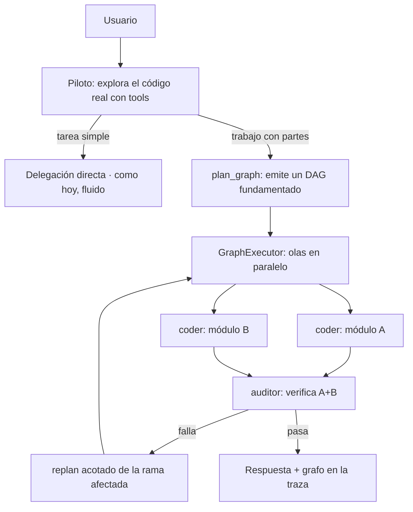

# Plan — devolver (y mejorar) el grafo de ejecución

**Fecha:** 2026-10-23 · **Estado:** propuesta, sin implementar.

## El problema de identidad

Satellite se distinguía de un «agente con tools» (Claude Code, opencode, Cursor…) por el
**planificador + ejecutor de grafos**: convertía una tarea en un DAG de microagentes
especializados y lo ejecutaba con paralelismo, aristas condicionales, reintentos por
nodo y límites. En la fase 6b lo borramos (`core/graph.py`, `planner.py`, `runner.py`,
`orchestrator.py`) para que el flujo fuera fluido como Claude Code.

El efecto no buscado: al hacerlo *fluido como Claude Code*, quedó *igual que Claude
Code*. El piloto es un agente que encadena tool calls y delega de uno en uno, en un bucle
oculto. Eso es correcto y se siente bien, pero no es diferencial.

## Qué estaba mal de verdad (y qué no)

El veredicto de la auditoría fue «enrutado por regex + planificador ciego». Mirando el
código borrado, el defecto **no era el grafo**, era *cómo se llenaba*:

- El planner leía `project_context`, pero solo el **índice** (rutas y símbolos), nunca el
  código real: planificaba sin abrir un archivo.
- Planificaba el **grafo entero de una vez**, antes de explorar; el plan nacía obsoleto.
- Se llegaba a él por **regex**, no por comprensión.

El piloto arregló esas tres cosas: lee el código real con tools antes de decidir. Pero
tiró el grafo con el agua sucia. **La tesis de este plan: conservar el piloto como
conductor que explora, y que su decisión sea un grafo explícito, no un bucle oculto.**

## El diferencial, reformulado

> Un agente que, **tras explorar el código real**, emite un **grafo de ejecución
> inspeccionable, editable, paralelo, con verificación y reanudable**, de microagentes
> especializados — y lo **replantea** cuando un nodo descubre algo que cambia el plan.

Ningún producto de «agente + tools» hace esto: encadenan llamadas en un solo hilo y un
solo contexto. Satellite ejecutaría ramas en paralelo (p. ej. tres coders en tres
módulos independientes, más un auditor que espera a los tres), con puertas de
verificación entre nodos, y sobreviviendo a un corte a mitad.

## Lo que se reutiliza (no se parte de cero)

- **Del repo actual:** `EventType.GRAPH_BUILT` (vive), `turn_trace` (ya registra
  delegaciones: pasa a ser el grafo), el patrón de olas en paralelo de `spawn_agent`
  (`agents/runtime.py`, `asyncio.gather`), `DelegationManager` (presupuesto compartido,
  profundidad, ciclos, aprobación por turno), `store.save_state` (persistencia del turno).
- **Del git (`27b4c1b~1`):** `core/graph.py` (`Node`/`Edge`/`EdgeCondition`/`GraphLimits`),
  y `runner.py::_run_dag_parallel` (ejecución por olas). Se recuperan como esqueleto y se
  **modernizan**, no se reviven tal cual.

## Qué cambia respecto al grafo viejo (para que sea factible)

| Defecto viejo | Mejora |
|---|---|
| Planificaba a ciegas (solo el índice) | El piloto **explora con tools** y recién entonces emite el grafo |
| Enrutado por regex | El grafo nace de una **decisión del modelo** (tool `plan_graph`), no de patrones |
| Grafo rígido, plan de una vez | **Adaptativo**: puertas de verificación y **replan acotado** de la rama que falla; un nodo puede expandirse en subgrafo |
| Siempre construía grafo (hasta para un saludo) | **Opt-in por forma**: tarea de un paso = delegación directa (fluido); el grafo entra solo cuando hay partes paralelas o dependientes reales |
| Planner y runner como capa separada y acoplada | El grafo es un **artefacto del turno del piloto**, no otro orquestador |
| No se veía ni se reanudaba | Grafo **persistido**, **en vivo** en TUI/escritorio (la vista de traza que ya existe), y **reanudable** desde los nodos completados |

## Fases (cada una con test y puerta de viabilidad)

Regla: cada fase se compara con el piloto-solo actual en `scripts/eval_flow.py`. **Si una
fase no mejora en algo medible (menos tokens, menos tiempo, o una tarea que antes no
salía) sin empeorar las comprobaciones, se revierte esa fase.** El piloto-solo es el
suelo seguro al que siempre se puede volver.

### Fase 0 · Modelo del grafo (sin ejecutarlo todavía)
Recuperar y modernizar `core/graph.py`: `Node` (delega en un agente del catálogo, con
`task`, `depends_on`, `max_retries`), aristas de dependencia y condicionales, `GraphLimits`.
Serialización ↔ `turn_trace`. Sin runner aún.
**Test:** construir, validar (ciclos, nodos inalcanzables, límites), (de)serializar.
**Viabilidad:** ninguna conducta de usuario cambia; es andamiaje.

### Fase 1 · Ejecutor por olas sobre la delegación actual
`GraphExecutor`: toma un grafo y lo ejecuta con `DelegationManager`, en olas paralelas
(reutiliza el patrón de `spawn_agent`), respetando dependencias, reintentos por nodo,
el presupuesto de tokens compartido y la cancelación cooperativa. Emite `GRAPH_BUILT` y
eventos por nodo.
**Test:** DAG con dos ramas independientes corre en paralelo; una rama que falla no mata
la otra; se respeta `depends_on`; cancelar a mitad deja lo hecho.
**Viabilidad:** un caso con partes independientes termina en **menos tiempo** que en
serie (medido en el benchmark).

### Fase 2 · El piloto emite el grafo (tool `plan_graph`), opt-in por forma
Nueva tool del piloto: tras explorar, puede emitir un grafo de delegaciones en vez de
delegar una a una. El prompt decide: un paso → `delegate` directo (como hoy); varias
partes independientes o dependientes → `plan_graph`. El grafo pasa por aprobación del
turno igual que una delegación.
**Test:** «arregla A y B, que son independientes» produce un grafo de 2 nodos que corren
en paralelo; «arregla el login» sigue siendo una delegación directa (sin grafo).
**Viabilidad:** «hazlo» (el caso caro del benchmark) baja llamadas/tokens al paralelizar;
un saludo o un cambio simple **no** construye grafo (no regresa la fluidez).

### Fase 3 · Adaptación: verificación y replan acotado
Puertas de verificación entre nodos (un auditor que depende de varios coders). Si un nodo
falla o su verificación no pasa, se **replantea solo esa rama** (límite de replanes, como
el viejo `max_replans`), sin rehacer el grafo entero. Un nodo puede expandirse en subgrafo
cuando descubre más trabajo del previsto.
**Test:** un coder cuyo test falla dispara un replan de su rama, no del grafo; el replan
está acotado y no hace bucle.
**Viabilidad:** una tarea multi-módulo que el piloto-solo dejaba a medias (agotaba rondas)
ahora termina.

### Fase 4 · Inspeccionable y reanudable
Persistir el grafo en el estado del turno. La vista de traza de TUI/escritorio (que ya
construimos) pasa a mostrar el **grafo en vivo** (nodos, estado, dependencias). Un turno
cortado o caído se **reanuda** desde los nodos ya completados en vez de empezar de cero.
**Test:** matar el proceso a mitad y reanudar ejecuta solo los nodos pendientes; la UI
refleja el grafo.
**Viabilidad:** reanudar un «hazlo» interrumpido no repite el trabajo ya hecho.

## Riesgos y cómo se acotan

- **Regresar a la ceguera.** El grafo se emite **después** de explorar, nunca antes, y
  nace de la decisión del piloto, no de regex. Puerta: si un caso simple construye grafo,
  es un bug de la fase 2, no un «así es».
- **Perder la fluidez.** El grafo es opt-in por forma; las tareas de un paso siguen siendo
  una delegación directa. Se mide en el benchmark que saludo/cambio no cambian.
- **Sobre-ingeniería.** Cada fase tiene puerta de viabilidad medida y es reversible al
  piloto-solo. Si la fase 1 no da paralelismo útil, el plan se detiene ahí sin deuda.
- **Doble descomposición** (piloto → grafo → nodo que a su vez delega/spawnea). Se reusa
  el límite de profundidad y el presupuesto de tokens que ya tiene `DelegationManager`.
- **Coste de los replanes.** Acotados por número y por rama (no por grafo); el presupuesto
  de tokens del turno los frena.

## Criterio de éxito global

Al terminar la fase 2, una tarea con partes independientes debe resolverse en **menos
tiempo y con menos o igual coste** que el piloto-solo, con las mismas comprobaciones en
verde, y las tareas simples deben seguir sin grafo. Si no, se revierte y Satellite se
queda como está hoy: no se cambia identidad por identidad, se cambia por algo medible.

## Qué NO hace este plan

- No vuelve el enrutado por regex ni el planner ciego: eso se quitó con razón.
- No toca el flujo de un turno simple: saludo, pregunta, cambio de un archivo siguen igual.
- No se implementa aquí: esto es el plan. La fase 0 empieza cuando lo valides.
